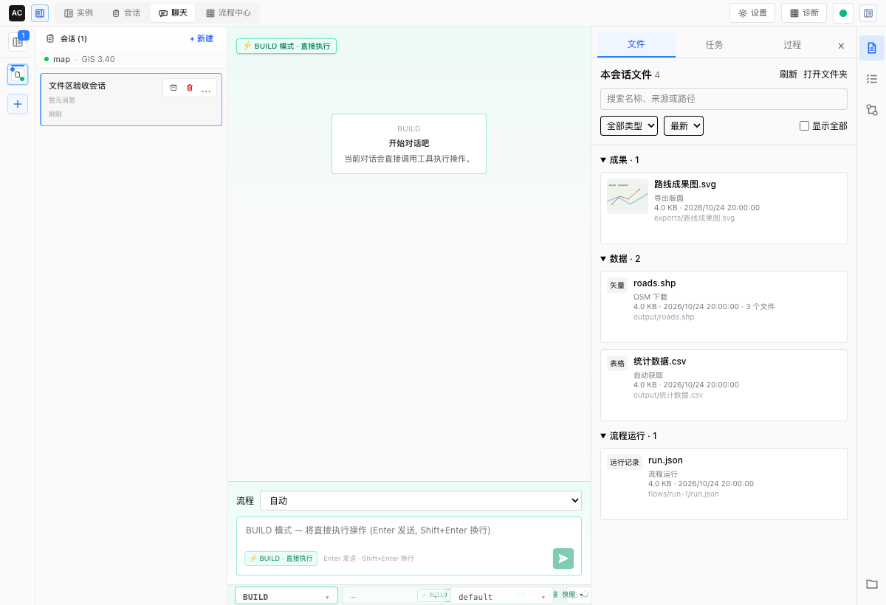
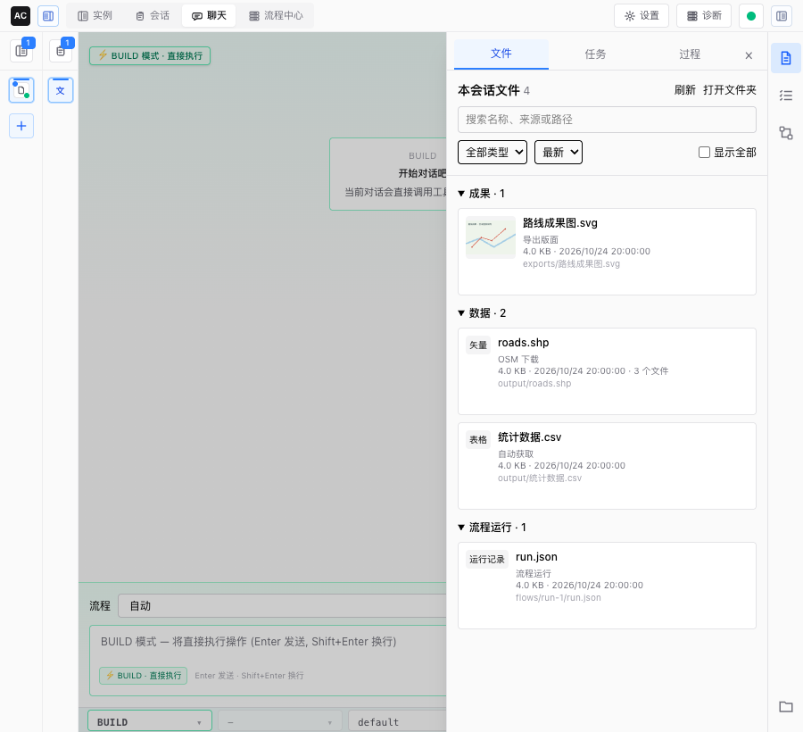

# F72 前端：会话工作区与文件区

## 结论
完成。1200 与 900 像素浏览器交互验收均通过。

## 改动摘要
- 新增：常驻图标栏，文件/任务/过程页签，可调宽面板、窄窗抽屉、全屏预览；文件分组、搜索、筛选、排序、刷新、已读记录、工具和流程产物定位。
- 新增：图片、PDF、CSV、文本、压缩文件和流程记录预览；连接绑定 QGIS 时数据信息、缩略图和加载；样式/版面可导入资源库。
- 修改：顶栏与“查看详情”进入工作区；任务、只读待确认与过程折叠行为保留；流程结束时只在已打开面板中切到文件页签；工具结果传递真实调用编号以定位产物。
- 删除：RightInspector，功能和测试迁入工作区。
- 新登记的兼容层：`inspector_workspace_state_v4`，旧详情状态接口映射一版。

## 运行的命令与结果
| 命令 | 结果 |
|---|---|
| npm test | 77 文件、395 项通过；6 项既有真实 API 测试条件不具备而跳过 |
| npm test -- src/components/workspace src/components/providers/WebSocketProvider.test.tsx | 最终调用编号补充后 36 项通过，含新增 2 项工具产物定位测试 |
| npm run lint | 通过，无错误或警告 |
| npx tsc --noEmit | 通过 |
| AUTOCARTO_PLAYWRIGHT_FRONTEND_PORT=50190 AUTOCARTO_TEST_RUNTIME_PORT=50189 AUTOCARTO_PLAYWRIGHT_USE_DEV_SERVER=1 npm run test:e2e -- tests/e2e/session-workspace.spec.ts | 2 项通过，23.6 s（含准备服务） |
| go test ./internal/control -run TestCompatLayerRequiresRemovalCriteria -count=1 | 通过，0.550 s |
| go test ./internal/websocket -run 'TestTool\|TestConsume\|TestRuntime' -count=1 | 通过，0.889 s |

## 计数与耗时
| 场景 | 模型调用次数 | 耗时 |
|---|---:|---:|
| 浏览器工作区操作，1200/900 像素 | 0（HTTP/WS 合成夹具） | 每项约 1.2 s |

## 布局截图
已目视核对聊天区、分组、选中颜色与抽屉遮罩。测试断言两种宽度下聊天容器均不少于 420 像素；1200 是并排面板，900 是抽屉。

## 跳过的测试及原因
- 浏览器测试采用合成文件和 HTTP/WS 回放；没有访问真实用户运行目录、模型、外网或系统文件管理器。
- 真实 QGIS 信息/缩略图工具已由 F61 验证，本卡通过 F71 契约调用；工作区真实 QGIS 综合验收留 F51。
- 既有 `api.real.test.ts` 的 6 项需要独立真实 API 环境，默认跳过，不算通过。

## 与方案不一致之处
无。

## 修改了涉及范围以外的文件
- `types/message.ts`、`components/providers/WebSocketProvider.tsx`、`internal/websocket/task_runner.go`：原工具卡随机展示编号无法与文件索引真实调用编号对应，增加可选 call_id 透明传递；保留原展示编号和旧结果路径匹配。
- `docs/refactor-v4/evidence/F71.md`：补记既有资源保存测试导致 API 全包阻塞的事实。

## 遗留问题与后续任务需要知道的事
- F31 可继续扩展当前流程/获取进度；已有工作区页签、消息定位和文件入口不应退化。
- 右侧文件区不提供删除、改名或任意工程目录浏览。
